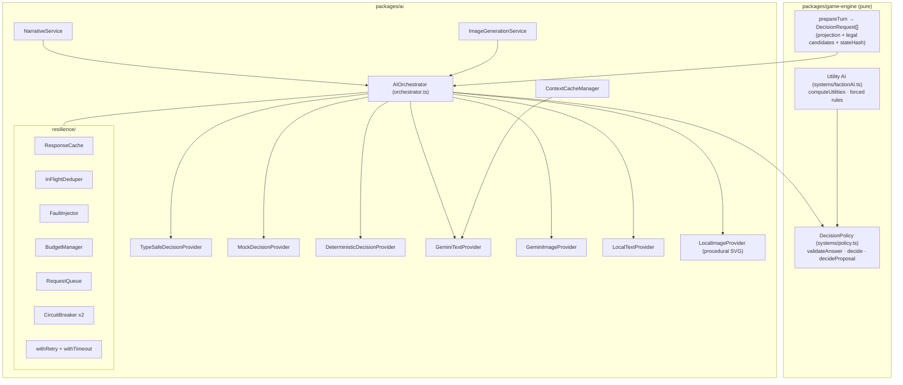
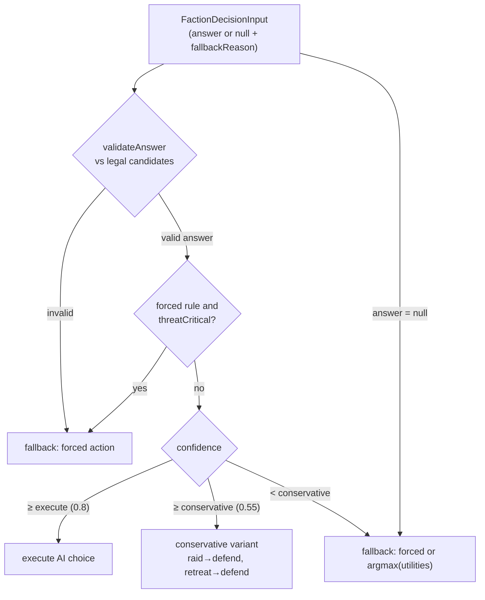
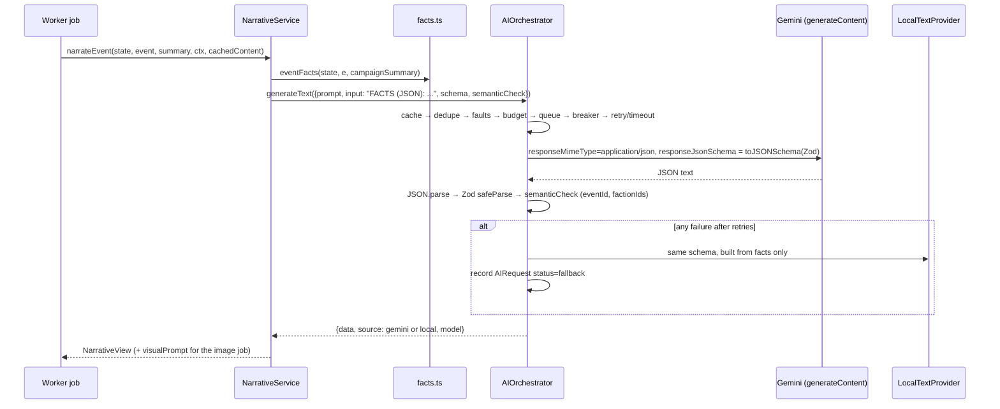
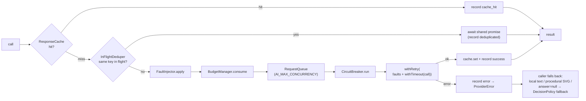

# AI Architecture

Echoes of the Frontier uses three kinds of AI, each with a narrow job:

| Capability | Provider | Runs in | Can it change game state? |
|---|---|---|---|
| Strategic faction decisions | **TypeSafe System One** (`@typesafe-ai/sdk`) | API, during END_TURN | Only as *validated input* to the engine's `DecisionPolicy`, which selects from legal candidates |
| Narrative (events, discoveries, intro, chronicle, quests, envoys) | **Gemini text** (`@google/genai`, structured JSON output) | Worker (BullMQ) | No. It is presentation only and stored outside the state hash |
| Illustrations (events, locations, portraits, technologies, hero art) | **Gemini image models** | Worker (BullMQ) | No. It is presentation only |

The rule behind all three: **the deterministic engine defines reality; AI advises and
describes.** Every AI path has a local fallback, so the game is fully playable with no keys,
no network, or a failing provider.

Related: [Architecture](architecture.md) · [Game design](game-design.md) · [Security](security.md)

---

## 1. Component map

`createAIServices` (`packages/ai/src/factory.ts`) builds everything. A live provider is
constructed **only** when its key exists and its effective mode is `live`. `buildAI`
(`packages/platform/src/ai.ts`) wires in Postgres telemetry (`PrismaAIRecorder`), the Redis
key-value store, and `FileSystemAssetStorage`.

---

## 2. AI modes

`AI_MODE` is read by `loadAIConfig` (`packages/ai/src/config.ts`) and resolved **per
provider** into `config.effective.{narrative, images, strategy}`:

| `AI_MODE` | Narrative and images | Strategy | Use |
|---|---|---|---|
| `auto` (default) | `live` if `GOOGLE_API_KEY` (or `GEMINI_API_KEY`) is set, else `mock` | `live` if `TYPESAFE_API_KEY` is set, else `mock` | Normal use. Add whichever keys you have. |
| `live` | Same resolution as `auto`: a missing key degrades that provider to `mock` | Same | Explicit live intent. |
| `mock` | Local template prose and procedural SVG art | `MockDecisionProvider` (realistic probabilities) | Offline play, CI, demos. |
| `deterministic` | Local providers | `DeterministicDecisionProvider` (no answer, so the engine's fallback policy decides) | Reproducible tests and debugging. |

`GET /ready` and the developer panel report the effective modes through `describeAIConfig`,
which never includes keys.

Provider health in the UI (`AIOrchestrator.status()`) is one of `online`, `degraded` (failure
in the last 60 s), `offline` (circuit open, disabled, or a forced fault) or `mock`. When
strategy is degraded the player sees: *"The frontier oracle is temporarily unavailable. Your
civilization can continue using fallback strategy."*

---

## 3. TypeSafe strategic decisions

### Request: legal candidates only

`buildDecisionRequests` (`packages/game-engine/src/systems/factionAI.ts`) creates one
`DecisionRequest` per living AI faction. Each request has three parts:

- **`projection`**: a reduced `StrategicStateProjection`. It holds the faction's personality,
  posture, resources, settlement count, population, military strength, tech count and food per
  turn; up to 5 nearest neighbours (status, opinion, strength, distance, trade, sanctions); up
  to 6 threats; territory and map facts; active events; the last 8 relevant history lines;
  pending proposals; and objectives. It is never the whole state.
- **`candidates`**: from `legalCandidates()`. These are the strategic actions the faction may
  legally take, the diplomatic stances legal toward one *stance target*, and the proposals
  addressed to it.
- **`stateHash`**: `hashObject({ projection, candidates })`. It is the cache key and the
  identifier recorded with the decision.

### Questions: Choice, Score, Noul

`buildQuestionSpec` (`packages/ai/src/typesafe/questions.ts`, prompt `faction_decision` v3,
schema `faction_decision_v3`) asks machine-readable questions. It never asks "what should we
do?" in free text.

| Key | Type | Asked when | Options / scale |
|---|---|---|---|
| `strategicAction` | `choice` | 2 or more legal actions | Subset of `expand, defend, trade, raid, research, retreat`, each with a description |
| `diplomaticStance` | `choice` | 2 or more legal stances | Subset of `improve_relations, maintain, sanction, declare_war, seek_peace, propose_alliance` |
| `threatLevel` | `score` | always | minimal → low → moderate → high → critical (0–4) |
| `foodUrgency` | `score` | always | no concern → minor → noticeable → serious → famine imminent (0–4) |
| `shouldAttack` | `noul` | always | probability that attacking now is justified |
| `acceptProposal<i>` | `noul` | per pending proposal | probability of accepting |

`TypeSafeDecisionProvider.decide` calls `client.systemOne({ state: projection, questions })`.
The SDK's own retries are disabled (`retry: { maxRetries: 0 }`, `logLevel: "off"`), because the
orchestrator owns the single retry policy.

### Answer validation (twice)

1. **In the provider** (`toStrategicAnswer`). Each answer is parsed with a Zod schema
   (`ChoiceResp`, `ScoreResp`, `NoulResp`), then the whole result is parsed with
   `StrategicAnswerSchema`. A semantic check then confirms the chosen action and stance are in
   the offered candidates. Any failure raises `ProviderError("malformed")`, which is retried
   and then falls back.
2. **In the engine** (`validateAnswer` in `systems/policy.ts`, called from
   `applyFactionDecisions`). The answer is re-validated against freshly computed candidates:
   `schema_invalid`, `illegal_action`, `illegal_stance` and `unknown_proposal` are rejected.
   This also protects replay, where answers come from the database.

### Model recording

TypeSafe returns the concrete model that served the request in `data.model`. That value is
stored in the answer (`StrategicAnswer.model`) and in `AIDecision.model`. When
`TYPESAFE_MODEL=jev-latest` (an alias), the record shows the resolved version (for example
`jev-1.13.0`). For reproducible deployments, pin `TYPESAFE_MODEL` to a concrete version.

### Error mapping

`mapTypeSafeError`: `RateLimitError` → `rate_limit` (honours `retryAfterMs`); timeouts and
aborts → `timeout`; connection errors → `unavailable`; 401/403 → `auth`; 400/404/422 →
`bad_request`; 408 → `timeout`; other statuses → `unavailable`.

---

## 4. DecisionPolicy and the utility-AI fallback

`decide()` in `packages/game-engine/src/systems/policy.ts` applies these rules:

| Strategic-action confidence | Mode | Result |
|---|---|---|
| `≥ executeThreshold` (default **0.8**) | `execute` | AI choice is executed |
| `≥ conservativeThreshold` (default **0.55**) and `< executeThreshold` | `conservative` | `CONSERVATIVE_VARIANT`: `raid → defend`, `retreat → defend`, others unchanged (and only if still legal) |
| `< conservativeThreshold`, or no or invalid answer | `fallback` | Deterministic: forced action if any, else `argmaxAction(utilities, legal)` |

Additional rules:

- **Survival beats AI.** If a hard rule forces an action (`threatCritical` → `defend`) and the
  AI disagrees, the forced action wins.
- **Stance.** Stance confidence `≥ execute` uses the AI stance. Confidence `≥ conservative`
  uses it too, except that `declare_war` is softened to `sanction` (or `maintain`). Otherwise
  the deterministic stance argmax is used.
- **War needs two signals.** `declare_war` stands only if `shouldAttack` is `≥ execute`, or
  `≥ conservative` with personality aggression above 0.6. Otherwise it degrades to `sanction`
  or `maintain`.
- **Urgency.** `urgentDefense` and `urgentFood` are set by deterministic flags or by AI
  `threatLevel` / `foodUrgency` scores of 3 or more.
- **Proposals.** `decideProposal` accepts if AI probability `≥ execute`, rejects if
  `≤ 1 − execute`. In between it accepts when the deterministic acceptance probability is at
  least 0.35 (conservative band) or 0.5. Without an AI answer it uses the deterministic rule at
  0.5. Every proposal is also checked with `proposalStillLegal`.

**Configuration.** The thresholds come from `AI_EXECUTE_THRESHOLD` and
`AI_CONSERVATIVE_THRESHOLD`; startup fails unless execute is greater than conservative. They
are copied into `GameState.config.aiPolicy` when a game is created, so each campaign (and its
replay) keeps the policy it started with.

### Deterministic utility AI

`computeUtilities` scores each action from personality, economy and the threat picture:

| Action | Utility |
|---|---|
| expand | `expansion + (sites ? 0.4 : −2) + (settlements < 3 ? 0.35 : 0) − (atWar ? 0.3 : 0)` |
| defend | `0.35 + (1 − aggression)·0.2 + (atWar ? 0.35 : 0) + (threatCritical ? 1 : 0) + lostAdapt` |
| trade | `mercantile·0.95 + (atWar ? −0.3 : 0.1)` |
| raid | `aggression·0.9 + (atWar ? 0.45 : −0.35) + (own > enemy·1.2 ? 0.25 : −0.4) − lostAdapt` |
| research | `science·0.95 + 0.1` |
| retreat | `(threatCritical ? 0.7 : −0.6) + settlementsLost·0.15` |

`threatCritical` = at war and enemy strength > 1.5 × own. `foodCritical` = negative food net
and fewer than 25 food. `lostAdapt` = 0.25 once the player has defeated the faction 3 or more
times. Forced rules: `threatCritical` → `defend`; at war with own strength > 1.5 × enemy →
`raid`. Stance utilities are computed the same way (for example, `declare_war` only scores when
opinion < −45 and own strength > target × 1.1).

The **`MockDecisionProvider`** (`local/decisionProviders.ts`) gives offline play realistic
probability distributions. It applies a softmax (temperature 0.35) over projection-derived
scores with noise seeded by `mock:<stateHash>`, so the confidence thresholds are genuinely
exercised. The **`DeterministicDecisionProvider`** returns no answer, which makes the result
identical to the fallback path.

---

## 5. Gemini text: NarrativeService

### Pipeline

- **Structured output.** `toResponseJsonSchema` converts the Zod schema with
  `z.toJSONSchema(schema, { target: "draft-2020-12" })`, which is sent as `responseJsonSchema`
  with `responseMimeType: "application/json"`. Defaults are temperature 0.9 and
  `maxOutputTokens` 2048. Free prose is never parsed with regex.
- **Schema validation.** `GeminiTextProvider` treats model output as untrusted and runs
  `schema.safeParse` on it. Failure is reported as `malformed`, which is retryable.
- **Semantic validation.** `semanticCheck` callbacks reject output whose `eventId`, `questId`
  or `factionId` does not match, or whose faction reactions name factions absent from the
  facts. Failure is reported as `malformed`, so the call is retried and then falls back.
  Reactions are also filtered to allowed factions before display.
- **Schemas** (`narrative/schemas.ts`): `WorldEventNarrative`, `DiscoveryNarrative`,
  `CampaignIntro`, `CampaignSummary`, `QuestNarrative`, `FactionNarrative`. All have bounded
  string lengths, and tone is an enum (`hopeful, ominous, tragic, triumphant, mysterious,
  tense, somber, wondrous`).

### Facts-only narrative policy

`packages/ai/src/narrative/facts.ts` extracts **structured facts** from the authoritative
state. Gemini never sees the whole state:

- `eventFacts`: the event's id, type, turn, era, region, biome, severity, duration, structured
  `cause`, consequences and immediate effects; up to 5 relevant factions (identity, opinion of
  the player, involvement); related history; and the campaign summary (≤ 1200 characters).
- `introFacts`, `summaryFacts`, `questFacts` and `factionFacts` follow the same pattern.
- `relevantHistory` scores history entries by shared region, faction or event tags and
  importance. Later stories can therefore reference earlier ones.

The shared system prompt (`NARRATOR` in `narrative/prompts.ts`) says: *use ONLY the facts
provided; never invent numbers, resources, deaths, technologies, factions or outcomes; the
engine has already decided all mechanics; copy faction ids exactly.* Quest narratives may only
restate the engine's fixed requirement and rewards.

Narratives are stored in the `Narrative` table, keyed by stable presentation keys (`eventKey`
includes type and turn). They are never part of `GameState` or its hash.

---

## 6. Gemini images: ImageGenerationService

### Prompt policy

`packages/ai/src/images/prompts.ts` builds every prompt from **canonical world facts** plus the
global **style bible** (`STYLE_BIBLE`: stylized high-end 3D strategy key art, painterly
surfaces, cinematic lighting, readable silhouettes, *no text, letters, logos, UI or watermark*):

| Request | Built from | Aspect ratio | Model |
|---|---|---|---|
| `eventImageRequest` | event scene template (`EVENT_SCENES`), tile biome and region, first involved faction's `visualIdentity`, era visuals (`ERA_VISUALS`), optional sanitised `visualPrompt` | 16:9 | `GOOGLE_IMAGE_MODEL`; `GOOGLE_IMAGE_HERO_MODEL` for `era_dawn` |
| `locationImageRequest` | POI scene template, biome, region, era | 16:9 | image model |
| `factionPortraitRequest` | faction identity, visual identity, colour, era | 3:4 | image model |
| `technologyImageRequest` | tech name, description, player visual identity, tech era | 1:1 | image model |
| `heroImageRequest` | intro or era chapter, capital biome and region, player identity, era | 16:9 | hero model |

Model-suggested detail goes through `sanitise()`: newlines are stripped, words like
`text/caption/logo/watermark/signature/letters` are removed, and the length is capped at 300
characters.

### Deduplication and storage

- `promptHash = sha256(model | promptId@version | aspectRatio | prompt)`. A local fallback image
  uses `sha256("local|" + promptHash)`.
- `ImageGenerationService.produce` first looks up `GeneratedAsset` by the expected
  `promptHash` and reuses it if the file still exists. Otherwise it generates the image through
  an `InFlightDeduper`, re-checks the hash it actually produced (a fallback differs), writes to
  storage, and creates the `GeneratedAsset` row (`promptHash` is `@unique`). **Identical prompts
  share one asset across all games**, and the same image is never generated twice.
- The worker then links the asset to the game through `GameAssetLink(gameId, key)` and
  publishes `image_ready`.
- `FileSystemAssetStorage` writes `<kind>/<first 2 hash chars>/<promptHash>.<ext>` under
  `ASSET_STORAGE_DIR`.
- **Local fallback.** `LocalImageProvider` renders a deterministic procedural SVG (sky
  gradient, layered ridgelines, silhouettes, palette chosen from the event's `visual.palette`).
  It is used in mock or deterministic mode, on any Gemini failure, and when the image budget is
  exhausted.

Images are produced only for events worth illustrating (major events and discoveries), newly
researched player technologies, new eras, the intro, and on-demand faction portraits. They are
never produced for every tick.

---

## 7. The orchestrator pipeline

`AIOrchestrator.run()` (`packages/ai/src/orchestrator.ts`) is the single gateway for live
provider calls:

### Caching

- **Cache key**: `cacheKeyFor(provider, model, promptId, promptVersion, input)` =
  `sha256("<provider>|<model>|<promptId>@<promptVersion>|<canonicalStringify(input)>")`.
  - TypeSafe input: `{ stateHash, factionId }`.
  - Gemini text input: the facts payload string.
  - Images use no response cache; they dedupe by `promptHash` in the database.
- Stored in Redis as `ai:cache:<key>` with a 30-day TTL. Because the prompt id, version and
  model are part of the key, a prompt or model change never serves stale output.

### Prompt versioning

`PROMPTS` in `packages/ai/src/narrative/prompts.ts` registers every prompt with a stable
`promptId` and an integer `promptVersion`. Both are recorded on every `AIRequest` and
`GeneratedAsset` row and folded into cache keys and `promptHash`.

| promptId | version | | promptId | version |
|---|---|---|---|---|
| `event_narrative` | 6 | | `event_art` | 3 |
| `discovery_narrative` | 4 | | `location_art` | 2 |
| `campaign_intro` | 3 | | `faction_portrait` | 2 |
| `campaign_summary` | 4 | | `technology_art` | 1 |
| `quest_narrative` | 3 | | `hero_art` | 2 |
| `faction_profile` | 3 | | `faction_decision` (TypeSafe) | 3 |

### Retries, backoff, jitter

`withRetry` (`resilience/retry.ts`):

- Attempts: `TYPESAFE_MAX_RETRIES + 1` (default **3**). The orchestrator uses this one policy
  for every provider.
- Backoff: attempt 1 immediately, attempt 2 after `base` (300 ms), attempt 3 after `base·4`
  (1200 ms), capped at 4000 ms, with ±30 % jitter.
- **Retryable**: `rate_limit`, `timeout`, `unavailable`, `malformed`. A provider
  `Retry-After` is honoured, capped at the maximum delay.
- **Not retryable**: `auth`, `bad_request`, `budget`, `disabled`, `circuit_open`, `safety`.
  Nothing retries forever.

### Timeouts

| Setting | Default | Applies to |
|---|---|---|
| `GOOGLE_TIMEOUT_MS` | 20 000 | Gemini text call (`withTimeout` plus SDK `httpOptions.timeout`) |
| `GOOGLE_IMAGE_TIMEOUT_MS` | 90 000 | Gemini image call |
| `TYPESAFE_TIMEOUT_MS` | 6 000 | TypeSafe client timeout (orchestrator allows +500 ms) |
| `TYPESAFE_TURN_DEADLINE_MS` | 15 000 | Hard deadline for **all** faction decisions in one END_TURN; it aborts in-flight calls, and unanswered factions fall back |

### Circuit breaker

`CircuitBreaker` (`resilience/circuitBreaker.ts`) runs one instance per provider (`gemini`,
`typesafe`) per process. After `AI_CIRCUIT_FAILURES` (default 5) consecutive countable failures
(`rate_limit`, `timeout`, `unavailable`, `malformed`) it opens and fails fast for
`AI_CIRCUIT_COOLDOWN_MS` (default 30 s). It then becomes half-open and allows a single trial
call. Caller mistakes (`bad_request`, `budget`, `disabled`) do not count.

### Budgets: cost control

`BudgetManager` (`resilience/controls.ts`) keeps counters in Redis, so all API and worker
processes share the same limits:

| Env | Default | Redis key | TTL |
|---|---|---|---|
| `MAX_AI_REQUESTS_PER_TURN` | 10 | `ai:budget:turn:<game>:<turn>` | 1 h |
| `MAX_IMAGES_PER_TURN` | 2 | `ai:budget:turn:<game>:<turn>:img` | 1 h |
| `MAX_AI_REQUESTS_PER_GAME` | 1500 | `ai:budget:game:<game>:all` | 90 d |
| `MAX_IMAGES_PER_GAME` | 60 | `ai:budget:game:<game>:img` | 90 d |
| `MAX_AI_REQUESTS_PER_USER_PER_DAY` | 3000 | `ai:budget:user:<player>:<YYYY-MM-DD>` | 26 h |

An exhausted budget raises `ProviderError("budget")`, which is not retried and does not count
against the circuit. The caller falls back to a local provider. Cache hits and deduplicated
calls never consume budget.

Other cost controls:

- the worker narrates at most 4 events per turn;
- images are made only for major events and discoveries;
- deterministic BullMQ job ids prevent duplicate work;
- the campaign summary is used as compressed memory instead of resending full history;
- context caching is optional (see below).

### In-flight dedupe and the request queue

- `InFlightDeduper` collapses concurrent identical requests (same cache key) into one provider
  call. `ImageGenerationService` has its own deduper keyed by `promptHash`.
- `RequestQueue` is a FIFO with a concurrency limit (`AI_MAX_CONCURRENCY`, default 6) for
  outbound calls in each process.

### Context caching (off by default)

`ContextCacheManager` (`packages/ai/src/gemini/contextCache.ts`) can create a Gemini explicit
context cache. The cache holds the permanent lore bundle: every faction's identity and visual
identity, the game rules statement, and the campaign summary. The worker uses it for
`event_narrative`. It is used only when all of these hold:

- `GOOGLE_CONTEXT_CACHE=true`;
- narrative is `live`;
- the content is at least 16 000 characters (below that, caching costs more than it saves).

The cache TTL is 1 h. Its name is stored in Redis (`ai:ctxcache:<game>:<hash>`) and reused.
When `cachedContent` is supplied, the system instruction comes from the cache. Cache creation
failures are logged and ignored.

---

## 8. Fault injection (developer controls)

`FaultInjector` stores flags in Redis (`ai:dev:faults`, 12 h TTL; each process caches them for
1 s), so every API and worker process sees the same flags:

| Flag | Effect |
|---|---|
| `disableGemini` | Gemini calls throw `disabled` → local prose and procedural art |
| `disableTypeSafe` | TypeSafe calls throw `disabled` → `answer: null`, `fallbackReason: "typesafe_disabled"` → deterministic policy |
| `forceRateLimit` | Every live call throws a simulated 429 (`rate_limit`). It is retried with backoff, can open the circuit, then falls back |
| `forceTimeout` | Every live call throws `timeout`. It is retried, can open the circuit, then falls back |

You can toggle the flags from the in-game **AI** button in the top bar (developer panel),
which also shows telemetry and a **Verify replay** button. The same controls are available
through `GET/POST /internal/ai/faults` when `DEV_TOOLS_ENABLED=true`. Faults apply only to
`live` providers; mock and deterministic providers never fail.

---

## 9. Deterministic state and replay

- AI output enters the authoritative state **only** through `completeTurn(state, inputs)`.
  There it is re-validated and filtered through `DecisionPolicy`, and combat, economy and
  events stay deterministic (seeded RNG).
- The `FactionDecisionInput[]` used for each END_TURN is persisted in `GameCommand.aiInputs`.
- `replay()` (`packages/game-engine/src/replay.ts`) and `GameRepository.load` feed those stored
  inputs back in. **Replay never calls an AI provider**, so a campaign is reproducible even
  after a model changes, a provider is down, or keys are removed.
- Narratives and images are presentation only and never part of `GameState` or its hash.

---

## 10. AI memory

| Memory | Where | Purpose |
|---|---|---|
| **Decision history** | `AIDecision` table | Each faction decision: `stateHash`, `provider`, resolved `model`, `questionSchemaVersion`, the full `answer`, chosen-option `probability`, `confidence`, `fallbackUsed`, `fallbackReason` (e.g. `typesafe_timeout`, `deterministic_mode`), `latencyMs`, `requestId`, `correlationId`. After the turn, `recordExecution` attaches the engine's executed outcome (`executionResult` = action, stance, mode, source, reason). |
| **Request telemetry** | `AIRequest` table | One row per call chain: provider, model, operation, promptId and version, cache key, status (`success`, `cache_hit`, `deduplicated`, `fallback`, `error`), error kind, latency, retry count, input and output tokens. Summarised by `telemetrySummary` for `/internal/ai/telemetry`. |
| **In-world faction memory** | `GameState.factions[].memories`, `opinions`, `personality`, `goals`, `posture` | Deterministic memories (`attacked_us`, `broke_treaty`, `deforested`, `gift`, ...) shift opinions. Long-memory factions drift back to neutral more slowly. Factions adapt permanently, for example abandoning aggression after 3 defeats. |
| **Campaign history** | `GameState.history`, `HistoricalEvent` | Importance-ranked log. Minor entries are pruned after 12 turns; important ones are kept. |
| **Compressed narrative memory** | `Narrative` key `summary` | A Gemini (or local) chronicle regenerated every 10 turns and on era change. It is reused as `campaignSummary` in event facts and the context-cache lore bundle. |

---

## 11. Configuration reference

All AI settings are server-side environment variables, parsed by Zod in
`packages/ai/src/config.ts`:

| Variable | Default |
|---|---|
| `AI_MODE` | `auto` |
| `GOOGLE_API_KEY` (canonical) / `GEMINI_API_KEY` (fallback) | — |
| `GOOGLE_TEXT_MODEL` / `GOOGLE_IMAGE_MODEL` / `GOOGLE_IMAGE_HERO_MODEL` | `gemini-3.8-flash` / `gemini-3.1-flash-image` / `gemini-3-pro-image` |
| `GOOGLE_CONTEXT_CACHE` | `false` |
| `GOOGLE_TIMEOUT_MS` / `GOOGLE_IMAGE_TIMEOUT_MS` | 20000 / 90000 |
| `TYPESAFE_API_KEY`, `TYPESAFE_MODEL`, `TYPESAFE_BASE_URL` | —, `jev-latest`, SDK default |
| `TYPESAFE_TIMEOUT_MS` / `TYPESAFE_MAX_RETRIES` / `TYPESAFE_TURN_DEADLINE_MS` | 6000 / 2 / 15000 |
| `MAX_AI_REQUESTS_PER_TURN` / `_PER_GAME` / `_PER_USER_PER_DAY` | 10 / 1500 / 3000 |
| `MAX_IMAGES_PER_TURN` / `MAX_IMAGES_PER_GAME` | 2 / 60 |
| `AI_EXECUTE_THRESHOLD` / `AI_CONSERVATIVE_THRESHOLD` | 0.8 / 0.55 |
| `AI_CIRCUIT_FAILURES` / `AI_CIRCUIT_COOLDOWN_MS` | 5 / 30000 |
| `AI_MAX_CONCURRENCY` | 6 |
