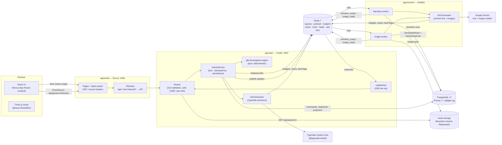
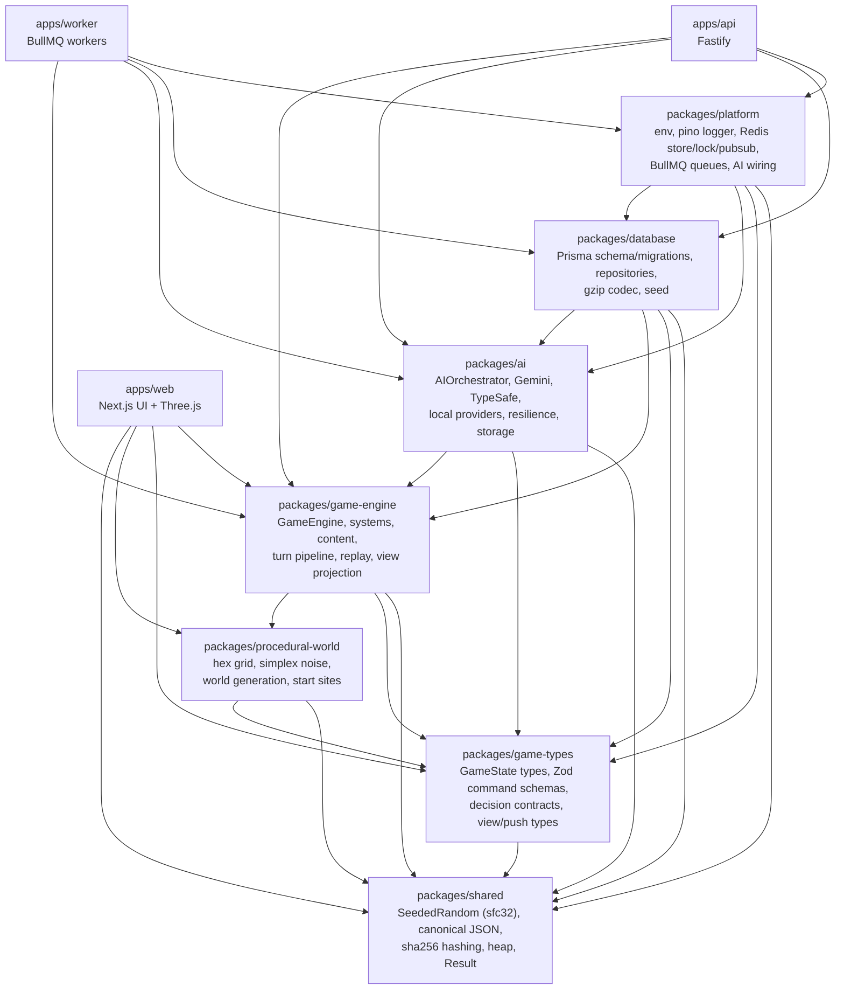
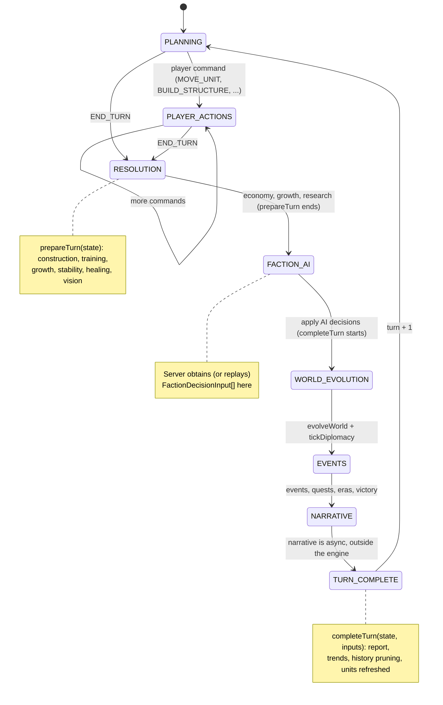
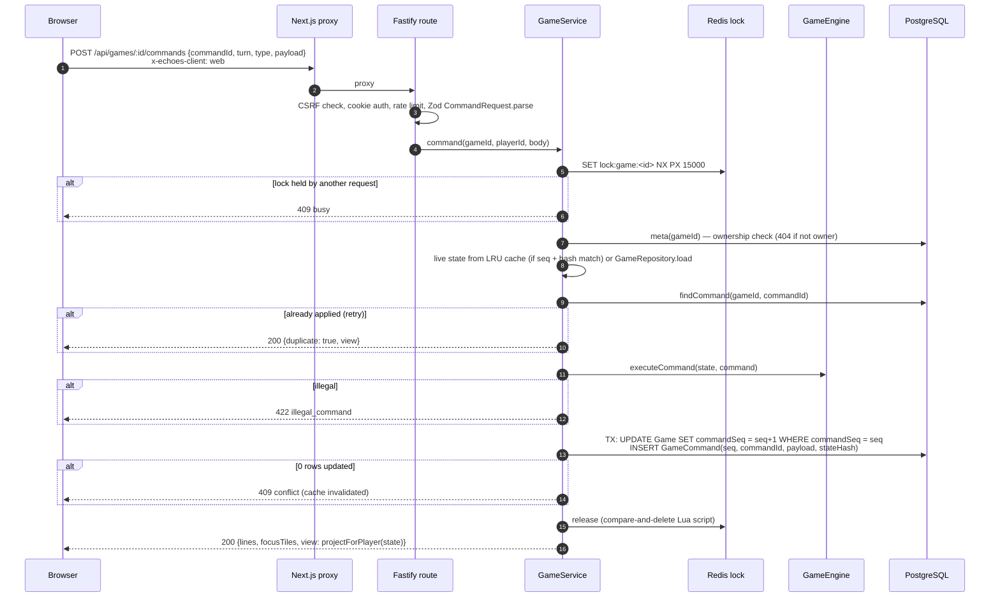
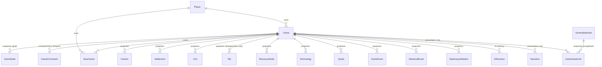
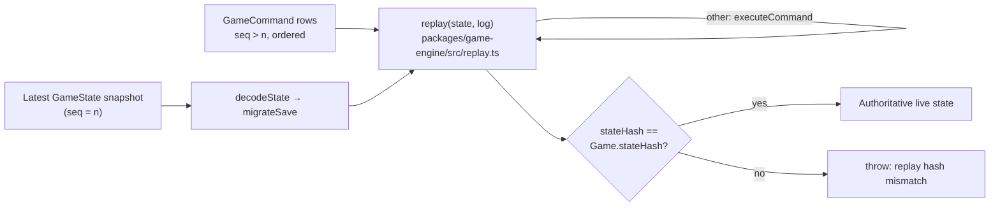
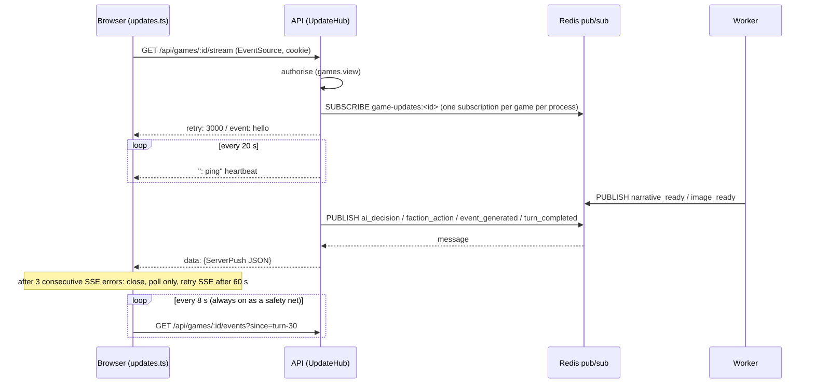
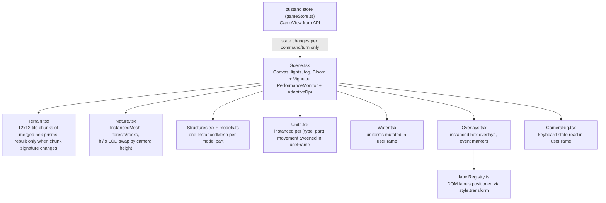

# Architecture

Echoes of the Frontier is a server-authoritative, turn-based strategy game. A pure,
deterministic TypeScript game engine owns reality; everything else (HTTP, persistence,
AI, rendering) is an adapter around it.

- **The browser expresses intent.** It sends commands like "move unit X to tile Y" and
  never sends resource values, stats, or outcomes.
- **The server validates and executes.** The Fastify API checks every command against the
  authoritative state and runs it through the `GameEngine`.
- **AI is advisory and presentational.** TypeSafe answers become *validated inputs* to a
  deterministic decision policy. Gemini only describes and illustrates facts the engine
  already decided.
- **Everything is replayable.** The command log stores the AI decisions that were used, so
  a game can be rebuilt bit-for-bit without calling any AI provider.

Related documents: [AI architecture](ai-architecture.md) · [Game design](game-design.md) · [Security](security.md)

---

## 1. System overview

| Container | Image target | Port (host binding) | Responsibilities |
|---|---|---|---|
| `postgres` | `postgres:17-alpine` | `127.0.0.1:5432` | Authoritative persistence. Volume `pgdata`. |
| `redis` | `redis:7.4-alpine` (AOF on) | `127.0.0.1:6379` | BullMQ queues, pub/sub for SSE, AI budgets/cache/fault flags, per-game locks, rate-limit counters. Volume `redisdata`. |
| `migrate` | `migrate` | n/a | One-shot: `prisma migrate deploy`, then the idempotent demo seed. |
| `api` | `api` | `127.0.0.1:4000` | Fastify API, turn pipeline, TypeSafe decisions, SSE. Health: `/health`, `/ready`. |
| `worker` | `worker` | 4100 (health only, not published) | Gemini narrative and image jobs. Health: `:4100/health`. |
| `web` | `web` | `3000` | Next.js UI. It proxies `/api/*` and `/internal/*` to `API_INTERNAL_URL`. Health: `/healthz`. |

All app services wait for `postgres` and `redis` to be healthy and for `migrate` to finish
successfully. `web` waits for a healthy `api`. The containers are built from the root
`Dockerfile`, a multi-stage build with targets `migrate`, `api`, `worker` and `web`.

### Why a proxy

The browser talks only to `http://localhost:3000`. `apps/web/next.config.ts` rewrites
`/api/:path*` and `/internal/:path*` to the Fastify API server-side. This gives:

- a single origin, so cookies stay `SameSite=Lax` and the CSP can be `connect-src 'self'`;
- no API host, provider endpoint, or key anywhere in the client bundle;
- no CORS configuration at all. The API never answers CORS preflights, and the CSRF
  defence depends on that (see [security.md](security.md#csrf)).

---

## 2. Package layout

Two boundaries matter most:

1. **`game-engine` has no I/O dependencies.** It does not import React, Three.js, Prisma,
   Google, or TypeSafe. It is a pure function of `(GameState, command, AI inputs)`.
2. **`apps/web` never depends on `@echoes/ai`, `@echoes/database` or `@echoes/platform`.**
   The browser bundle cannot contain an AI SDK or a database client. The web app imports the
   engine only for client-side previews (legal-move highlighting, economy previews) and for
   shared constants. The server stays the authority.

| Path | Contents |
|---|---|
| `packages/shared/src` | `random.ts` (seedable sfc32 RNG; serialisable state), `hash.ts` (canonical JSON + sha256), `heap.ts`, `result.ts` |
| `packages/game-types/src` | `state.ts` (all domain types, `SAVE_SCHEMA_VERSION = 3`), `commands.ts` (Zod `CommandRequest`, `NewGameRequest`), `decisions.ts` (`DecisionRequest`, `StrategicAnswerSchema`), `view.ts` (`GameView`, `ServerPush`) |
| `packages/procedural-world/src` | `generate.ts`, `hex.ts` (odd-r pointy-top hex grid), `noise.ts` (simplex), `sites.ts` (start-site scoring) |
| `packages/game-engine/src` | `engine.ts`, `turn.ts`, `commands.ts`, `replay.ts`, `view.ts`, `legal.ts`, `hash.ts`, `migrations.ts`, `create.ts`, `content/*`, `systems/*` |
| `packages/ai/src` | `orchestrator.ts`, `config.ts`, `factory.ts`, `gemini/*`, `typesafe/*`, `narrative/*`, `images/*`, `local/*`, `resilience/*`, `storage/storage.ts`, `telemetry.ts` |
| `packages/database` | `prisma/schema.prisma`, `prisma/migrations/*`, `prisma/seed.ts`, `src/repositories.ts`, `src/codec.ts`, `src/client.ts` |
| `packages/platform/src` | `env.ts`, `logger.ts`, `redis.ts`, `queues.ts`, `ai.ts` |
| `apps/api/src` | `main.ts`, `server.ts`, `auth.ts`, `routes/{games,internal,health}.ts`, `services/{gameService,sse}.ts` |
| `apps/worker/src` | `main.ts` (narrative and image workers, health server) |
| `apps/web` | `app/*` (routes), `src/ui/*` (panels), `src/three/*` (renderer), `src/store/gameStore.ts`, `src/lib/{api,updates}.ts` |

---

## 3. Game engine and the turn pipeline

`GameEngine` (`packages/game-engine/src/engine.ts`) wraps pure functions:

| Method | Function | Notes |
|---|---|---|
| `GameEngine.createGame(opts)` | `create.ts` `createGame` | Generates the world from the seed, places 6 capitals, spawns starting units. |
| `executeCommand(cmd)` | `commands.ts` `executeCommand` | Validates against a *copy* of state; returns `{ok, state, error, lines, focusTiles, triggers}`. |
| `prepareTurn()` | `turn.ts` `prepareTurn` | RESOLUTION; returns `DecisionRequest[]` for AI factions. |
| `resolveTurn(inputs)` | `turn.ts` `completeTurn` | FACTION_AI → TURN_COMPLETE using supplied decisions. |
| `getLegalActions()` | `legal.ts` | Moves, attacks (with combat previews), research, training. |
| `calculateStateHash()` | `hash.ts` | sha256 over canonical JSON (sorted keys) of the full state. |

All randomness comes from `SeededRandom`. Its four-word state lives in `GameState.rng`, so a
saved game resumes exactly the same random stream.

### Turn state machine

The pipeline is deliberately **split at FACTION_AI** (`packages/game-engine/src/turn.ts`):

- `prepareTurn(state)` runs RESOLUTION for every faction (player first, then AI factions
  sorted by id) and returns a state in phase `FACTION_AI`, plus one `DecisionRequest` per
  living AI faction. Each request contains a reduced `StrategicStateProjection`, the
  **legal candidates** only, and a `stateHash` of both.
- Between the two halves, the API calls TypeSafe, or a mock or deterministic provider,
  through `AIOrchestrator.decideFactions`. That call has a hard turn deadline
  (`TYPESAFE_TURN_DEADLINE_MS`, default 15 s).
- `completeTurn(state, inputs)` validates every answer again and applies it through
  `DecisionPolicy`. It then runs world evolution, the event director, quests, era advance and
  victory checks, and produces the `TurnReport`.

Both halves are pure. That makes the AI call the only non-deterministic step, and its output
is stored.

---

## 4. Command flow: idempotency, locking, optimistic concurrency

Every command envelope (`CommandRequest` in `packages/game-types/src/commands.ts`) carries a
client-generated `commandId` (UUID) and the client's `turn`. `gameId` and `playerId` are
bound server-side from the route and the signed cookie; they are never taken from the body.

Three layers protect the log:

| Layer | Mechanism | Where |
|---|---|---|
| Idempotency | `@@unique([gameId, commandId])` on `GameCommand`; `findCommand` before executing. A retried request returns `duplicate: true` and nothing is applied twice. | `GameRepository.findCommand`, `GameService.command/endTurn` |
| Mutual exclusion | Per-game Redis mutex (`SET NX PX`, token-checked release). Commands use a 15 s TTL, END_TURN 90 s, Load 30 s. | `RedisLock` in `packages/platform/src/redis.ts` |
| Optimistic concurrency | `Game.commandSeq` is a monotonically increasing sequence. The append is a conditional `updateMany ... WHERE commandSeq = expectedSeq`, plus `@@unique([gameId, seq])`. If the sequence moved, it raises `ConcurrencyError`, which becomes HTTP 409. | `GameRepository.appendCommand` |

**END_TURN** follows the same pattern (`POST /api/games/:id/end-turn`, or a `CommandRequest`
of type `END_TURN`), with these additions:

1. `prepareTurn` → `ai.decideFactions(requests)` → `completeTurn`.
2. An `ai_decision` push is published for each faction.
3. The `GameCommand` row is written **with `aiInputs`** (the `FactionDecisionInput[]` used).
4. The same transaction writes a gzip snapshot and rewrites the normalized projection.
5. After commit, the service enqueues narrative, quest, summary and image jobs, autosaves,
   and publishes `faction_action`, `event_generated` and `turn_completed`.

---

## 5. Persistence: a hybrid model

`packages/database/prisma/schema.prisma` combines three representations.

| Representation | Tables | Purpose |
|---|---|---|
| **Command log** | `GameCommand` (`seq`, `commandId`, `type`, `payload`, `aiInputs`, `stateHash`) | The source of truth for history. END_TURN rows store the AI decisions that were used. |
| **Versioned snapshots** | `GameState` (`kind` = `initial` / `turn` / `load`, `seq`, `stateHash`, `schemaVersion`, gzip `data`) and `SaveGame` | Fast restore. A `turn` snapshot is written on every END_TURN; the 12 most recent `turn` snapshots are kept. `initial` and `load` snapshots are timeline roots and are never pruned. |
| **Normalized projection** | `Faction`, `Settlement`, `Unit`, `Tile`, `ResourceNode`, `Technology`, `Quest`, `GameEvent`, `HistoricalEvent`, `DiplomacyRelation` | Queryable view of the current state for history, telemetry and tooling. It is rewritten in the same transaction as each snapshot. `Tile` stores only tiles that diverge from base generation. |
| **AI memory and telemetry** | `AIDecision`, `AIRequest` | Explainable decision history and usage accounting (see [ai-architecture.md](ai-architecture.md#ai-memory)). |
| **Presentation** | `Narrative`, `GeneratedAsset`, `GameAssetLink` | Generated prose and art. Never part of the authoritative state or its hash. |

Serialisation (`packages/database/src/codec.ts`) is gzip-compressed JSON (level 6). Decoding
always runs `migrateSave` (`packages/game-engine/src/migrations.ts`). That function upgrades
v1→v2→v3 saves one step at a time and **rejects** unknown, future or corrupt saves instead
of loading them.

The database client is Prisma 7 with the `prisma-client` generator (output
`packages/database/src/generated/prisma`) and the `@prisma/adapter-pg` driver adapter
(`pg` pool, `max: 10`). All queries go through Prisma's query builder, and only one raw query
exists (`SELECT 1` in `/ready`, a tagged template).

---

## 6. Deterministic replay

- `replay(initial, log)` sorts entries by `seq`. Each `END_TURN` is replayed as
  `prepareTurn` + `completeTurn(entry.aiInputs)` and every other command through
  `executeCommand`. **No AI provider is ever called during replay.**
- `GameRepository.load(gameId)` restores the latest snapshot and replays only the commands
  logged after it. It then checks the result against `Game.stateHash` and throws on any
  mismatch, so silent divergence is impossible.
- `GameService.verifyReplay` (exposed as `GET /internal/games/:id/replay-verify` and as the
  "Verify replay" button in the developer panel) replays the full timeline from the most
  recent timeline root (`initial`, or the last `load`). It returns
  `{ ok, expected, actual, commands, root, rejected }`.
- `pnpm replay:verify` runs `scripts/replay-verify.ts` for command-line verification.
- Loading a save (`POST /api/saves/:id/load`) calls `GameRepository.resetTo`. That writes a
  new `load` snapshot at the current sequence and starts a new timeline root.

---

## 7. Real-time updates: SSE with polling fallback

- `UpdateHub` (`apps/api/src/services/sse.ts`) keeps one Redis subscriber connection per API
  process and fans each message out to all SSE clients for that game. This works across
  multiple API instances and for messages published by the worker.
- `ServerPush` types (`packages/game-types/src/view.ts`): `turn_completed`,
  `faction_action`, `ai_decision`, `narrative_ready`, `image_ready`, `event_generated`,
  `ai_status`.
- `connectUpdates` (`apps/web/src/lib/updates.ts`) opens an `EventSource`. After three
  consecutive errors it falls back to polling and retries SSE after 60 s. A light 8-second
  poll of `/api/games/:id/events` **always** runs, so a missed push only delays a narrative or
  image and never loses it.

---

## 8. Asset pipeline

```mermaid
flowchart LR
  T["Turn / command completes"] --> Q1["BullMQ echoes-narrative<br/>jobId = deterministic"]
  Q1 --> N["NarrativeService<br/>(Gemini text or local)"]
  N --> NR[("Narrative")]
  N -->|"major event or discovery"| Q2["BullMQ echoes-images<br/>jobId = deterministic"]
  T -->|"new tech / new era / intro"| Q2
  Q2 --> I["ImageGenerationService"]
  I --> H{"GeneratedAsset with<br/>promptHash exists<br/>and file present?"}
  H -- yes --> Link
  H -- no --> G["AIOrchestrator.generateImage<br/>(Gemini image, or procedural SVG fallback)"]
  G --> St["FileSystemAssetStorage.put<br/>kind/hh/promptHash.ext"]
  St --> GA[("GeneratedAsset")]
  GA --> Link[("GameAssetLink(gameId, key)")]
  Link --> P["publish image_ready"]
  P --> Get["GET /api/assets/:assetId<br/>(ownership check, sandbox CSP, immutable cache)"]
```

- Queues are defined in `packages/platform/src/queues.ts`: `echoes-narrative` and
  `echoes-images`, with 2 attempts and exponential backoff from 2 s. Deterministic job ids
  (`narrativeJobId`, `imageJobId`) give queue-level dedupe, because BullMQ ignores an
  `add()` whose id already exists.
- The worker (`apps/worker/src/main.ts`) runs narrative jobs at concurrency 2 and image jobs at
  concurrency 1. It narrates at most 4 events per turn, and only major events and discoveries
  get images.
- `FileSystemAssetStorage` (`packages/ai/src/storage/storage.ts`) writes to
  `ASSET_STORAGE_DIR` (the `assets` Docker volume at `/data/assets`). It accepts only safe keys
  (`/^[a-z0-9][a-z0-9/_.-]{0,200}$/`, no `..`, must resolve inside the base directory). The
  `AssetStorage` interface allows an S3 or GCS implementation without touching game code.

---

## 9. Rendering architecture

The 3D map lives in `apps/web/src/three` and is built with `@react-three/fiber`, `drei` and
`postprocessing`.

| Technique | Implementation |
|---|---|
| **Chunked terrain** | `chunkTiles(map, 12)` splits the 48x48 map into 16 chunks. Each chunk is one merged `BufferGeometry` (with `faceToTile` for picking), frustum-culled by three.js and rebuilt only when its `chunkSignature` (biome, fog, pollution) changes. |
| **Instancing** | Trees, rocks, buildings, units and overlays use `InstancedMesh`. Each part of a procedural model (`models.ts`) is one instanced mesh shared by every entity of that type, so the whole world draws in a few dozen calls. Faction-coloured parts use instance colours. |
| **LOD** | `Forests` checks the camera height about every 0.3 s and swaps between high- and low-poly geometries (camera `y > 42` uses low). |
| **Adaptive quality** | `PerformanceMonitor` drops the device pixel ratio from 1.5 to 1 when frame rate declines; `AdaptiveDpr` is enabled. Shadows are a user setting. |
| **`useFrame`-only animation** | Unit movement (interpolating `prevTile` → `tile`), water, overlays, camera motion, LOD checks and label positioning all happen in `useFrame` callbacks that mutate refs, matrices and uniforms. |
| **No React state in the render loop** | React re-renders only when the `GameView` changes (once per command or turn). Per-frame work never calls `setState`; DOM labels are moved through `style.transform` by `labelRegistry`. |
| **Accessibility settings** | Reduced motion (snaps instead of tweening), high contrast and shadows are toggled in settings. |

---

## 10. Health, shutdown and configuration

- **Health:** API `GET /health` (liveness) and `GET /ready` (Postgres `SELECT 1` and Redis
  `PING`, plus a key-free AI configuration summary and the SSE connection count); worker
  `GET :4100/health`; web `GET /healthz`. Docker health checks use these endpoints.
- **Graceful shutdown:** API and worker handle `SIGTERM` and `SIGINT`. They close the HTTP
  server or workers, the queues, Redis and Prisma, and force-exit after 10 s.
- **Configuration:** `packages/platform/src/env.ts` (`PlatformEnvSchema`) and
  `packages/ai/src/config.ts` (`loadAIConfig`) parse the environment with Zod. See
  [`.env.example`](../.env.example).
