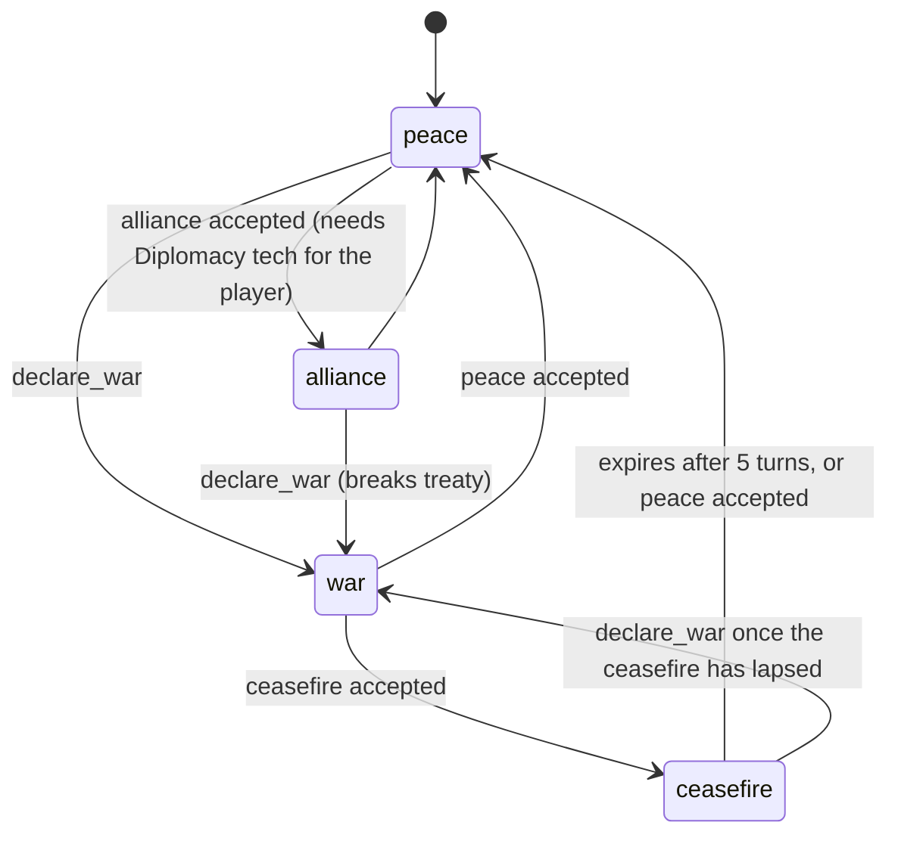

# Game Design

*Echoes of the Frontier* is a turn-based 4X strategy game. You lead the last surviving
civilization on a procedurally generated hex frontier, alongside five AI factions with
distinct personalities and long memories. The world itself evolves. Forests fall and regrow,
pollution spreads down rivers, deposits run dry, and the climate drifts. The consequences of
how you use the land come back as events, quests and diplomacy.

Every mechanic below lives in the deterministic engine (`packages/game-engine`). The numbers
are taken directly from the source. AI providers never compute outcomes; see
[ai-architecture.md](ai-architecture.md).

---

## 1. Game loop

One turn is one **year**. A campaign lasts up to `maxTurns` (default **100**).


During planning, the player issues commands. Each one is validated by the server
(`executeCommand`):

| Command | Effect |
|---|---|
| `MOVE_UNIT` | Move along reachable tiles (see [Movement](#movement)) |
| `ATTACK` | Attack a target in range while at war; `raze: true` destroys a captured settlement instead |
| `BUILD_STRUCTURE` | Place a building in your territory, or found a settlement with a Worker |
| `GATHER_RESOURCE` | A Worker harvests its tile directly (see below) |
| `TRAIN_UNIT` | Queue a unit in a settlement |
| `RESEARCH_TECH` | Set the current research |
| `DECLARE_TRADE` | Propose a trade agreement |
| `DIPLOMACY_ACTION` | gift, propose alliance/peace/ceasefire, declare war, sanction, lift sanction, espionage |
| `RESPOND_PROPOSAL` | Accept or decline an AI faction's proposal |
| `CLAIM_TERRITORY` | Buy a bordering tile with influence |
| `FORTIFY_UNIT` | +25 % defence until it moves |
| `END_TURN` | Run the turn pipeline |

**Gathering** (one action per Worker per turn) yields:

- from a resource node: up to 12 of the node's resource (iron → metal, stone deposit → stone,
  game herd or fish → food, sunstone → energy, relic → knowledge, salt → influence);
- otherwise from forest (≥ 10): wood, which thins the forest;
- otherwise from hills, mountain or desert: 5 stone;
- otherwise from fertile land (fertility > 30): 6 food, at −2 fertility.

**Discoveries.** Moving onto a point of interest (Explorers: within 1 tile, double rewards)
grants a one-time reward and creates a discovery event:

| POI | Reward |
|---|---|
| Ancient ruin | +30 knowledge, +10 influence |
| Monolith | +25 influence, +10 knowledge |
| Hot springs | +30 food |
| Crater | +25 metal, +15 knowledge, and reveals a relic deposit |
| Ruins (of a razed town) | +20 stone, +10 knowledge |
| Shipwreck | +30 wood, +10 metal |

---

## 2. Map generation

`packages/procedural-world/src/generate.ts` builds the map from the seed alone. Every step
uses its own `SeededRandom` stream (`elevation`, `ridge`, `moisture`, `temperature`, `lakes`,
`rivers`, `ecology`, `resources`, `poi`, `regions`, `start-sites`).

- **Grid:** 48 × 48 pointy-top hexes in odd-r offset layout (`hex.ts`); tile index =
  `row × width + col`.
- **Elevation:** simplex fBm plus squared ridge noise, minus a radial falloff, so the map edges
  become ocean and one continent forms. Sea level is 0.34.
- **Temperature:** latitude gradient (cold north, warm south) plus noise, lowered with
  altitude. **Moisture:** fBm noise, +0.12 next to water.
- **Biomes** (`classifyBiome`): ocean, shallows, beach, plains, grassland, forest, taiga,
  desert, tundra, wetland, hills, mountain, snow. Three more appear only through world
  evolution: scrubland, ashland, blighted.
- **Lakes:** inland local elevation minima with moisture > 0.45 (85 % chance).
- **Rivers:** up to 10 sources on moist hills or mountains flow downhill for up to 60 steps.
  A river ends at water or another river, or pools into a lake when blocked. River tiles are
  wetter, and river desert or plains become more fertile.
- **Ecology:** per-biome forest density, fertility (+20 on rivers) and habitat (60–90).
- **Resources** (amount 180–420 each), by biome:

  | Biome | Nodes (chance per tile) |
  |---|---|
  | hills | iron 14 %, stone 16 % |
  | mountain | iron 12 %, stone 10 %, sunstone 4 % |
  | desert | sunstone 10 %, salt 6 % |
  | forest / taiga / grassland / wetland | game herd 7 % / 8 % / 5 % / 3 % (grassland also salt 2 %) |
  | plains | stone 3 %, salt 3 % |
  | beach | salt 5 % |
  | shallows | fish 12 % |
  | tundra | iron 5 % |

- **POIs:** 7 ancient ruins, 2 monoliths (plains, desert or tundra), 2 hot springs (hills),
  1 crater, and 2 shipwrecks (beach), at least 6 hexes apart.
- **Regions:** named areas such as "the Amber Wilds", combining an adjective with a form taken
  from the dominant biome.
- **Start sites:** `findStartSites` scores tiles by preference (balanced, coastal, river,
  highlands, forest, desert) with a small seeded jitter. It keeps capitals at least 10 hexes
  apart, relaxing the distance down to 4 if needed.

---

## 3. Factions

The player plus five AI factions (`packages/game-engine/src/content/factions.ts`):

| Faction | Archetype | Home / site | Personality (aggr / merc / eco / sci / expand / memory) | Goals |
|---|---|---|---|---|
| **The Ironhold Compact** | aggressive | hills / highlands | 0.80 / 0.20 / 0.10 / 0.40 / 0.65 / 0.90 | control iron, military dominance |
| **The Saltwind Guild** | merchant | beach / coastal | 0.25 / 0.92 / 0.30 / 0.45 / 0.50 / 0.50 | trade network, wealth |
| **The Verdant Assembly** | ecological | forest / forest | 0.30 / 0.30 / 0.95 / 0.35 / 0.35 / 0.85 | protect forests, clean rivers |
| **The Lumen Concord** | technocratic | grassland / river | 0.35 / 0.50 / 0.30 / 0.95 / 0.45 / 0.60 | knowledge, ascension |
| **The Ashen Caravans** | nomadic | desert / desert | 0.55 / 0.55 / 0.40 / 0.25 / 0.80 / 0.45 | expand far, survive |

Each faction has an identity, a visual identity (used for art prompts), a list of settlement
names and preferred technologies.

**Starting position.** Every faction starts with a capital of population 3. The player also
gets 2 Workers, a Scout and a Guard; each AI faction gets a Worker, a Scout and a Guard.

**Initial opinions** are biased by archetype:

| Opinion holder | Toward | Opinion |
|---|---|---|
| ecological | aggressive | −15 |
| aggressive | merchant | −5 |
| merchant | everyone | +10 |
| technocratic | ecological | −5 |
| nomadic | aggressive | −10 |

**Dynamic factions** can appear during play:

- **Rebels.** When a neglected settlement rebels (see [Events](#8-events)), it becomes
  *The Free &lt;name&gt;* (archetype `rebel`, grey banners). It inherits its parent's
  technologies, is more aggressive, and starts at war with its former ruler (opinion −60).
- **Heirs.** Eight or more turns after a settlement is razed, its descendants may return to
  rebuild *New &lt;name&gt;* on the ruins. If the founding faction is gone, they come back as
  a new faction, *The Heirs of &lt;name&gt;*, which holds a −50 opinion of whoever razed it.

**AI behaviour.** AI factions hold at most 6 settlements. Each turn they choose a strategic
action (expand, defend, trade, raid, research, retreat) and a diplomatic stance toward one
neighbour, through TypeSafe and the `DecisionPolicy`. They build 1 economic building per turn
(2 on Warlord), counter-attack adjacent enemies, and send scouts to explore. They **adapt
permanently**:

- After 3 or more defeats by the player, an aggressive faction drops aggression by 0.25, gains
  science, and adopts a `fortify_homeland` goal.
- The Verdant Assembly radicalises against heavy polluters (player territory pollution > 150):
  aggression rises by 0.2 and opinion drops by 20.

---

## 4. Resources and economy

Seven resources: **food, wood, stone, metal, energy, knowledge, influence**.
`computeFactionEconomy` (`systems/economy.ts`) is a pure function, shared by turn resolution and
client-side previews.

**Production.** Each completed building is staffed by settlement population in order, up to
its `jobs`. Output scales with the staffed fraction, then is multiplied by:

- the technology multiplier for that resource;
- Workshop ×1.2 (wood, stone, metal);
- active event multipliers;
- difficulty: AI ×0.85 / 1 / 1.2 and player ×1.15 / 1 / 0.95 (Settler / Governor / Warlord);
- low stability: ×0.75 when settlement stability < 25.

**Terrain and site modifiers:**

| Building | Modifier |
|---|---|
| Farm | food × clamp(fertility / 60, 0.3, 1.5), + tech flat bonus, +1 on a river, +2 on a game herd |
| Lumber camp | wood × clamp(forest / 60, 0.2, 1.4) |
| Quarry | +1 on hills or mountain, +3 on a stone deposit |
| Mine | iron node: 6 + tech metal; sunstone node: 6 energy and no metal; otherwise 2 + tech metal; relic node: +3 knowledge |
| Settlement center | +0.2 knowledge and +0.1 influence per population, +2 food on fish |
| Market | + tile prosperity / 25 influence |
| Any building | prosperous tiles (> 20) multiply every positive output by (1 + prosperity / 500); farms and lumber camps lose output when tile pollution > 30 |

**Upkeep.**

- Building upkeep applies only while the building is staffed.
- Every citizen eats 1 food per turn, and units eat their `upkeepFood`.
- With Clean Energy, power plants need no wood. With Hydroponics, farms cost +0.5 energy.

**Trade.** Each active trade agreement yields, multiplied by (1 + tech trade bonus + 0.5 if you
own a Market):

- +2 influence, +1 knowledge and +2 food;
- +2 of the partner's specialty: metal from aggressive partners, wood from ecological,
  knowledge from technocratic, food from nomadic, and stone from the rest.

**Sanctions** reduce influence income by 30 % per sanctioning party, to a minimum of ×0.4.

**Storage.** The base cap is 150 per resource, plus building storage. Knowledge is capped at
max(cap, 400) and influence at 999. Stockpiles are clamped to [0, cap] each turn.

**Growth.** When food is positive, each settlement gains its share of net food × growth
multiplier. It grows by 1 population when growth reaches `8 + 3 × population`, if housing
allows. Housing = 6 + tech housing + building housing.

**Famine.** If food would go negative, the largest settlement loses 1 population and 8
stability.

**Stability** moves at most ±6 per turn toward a target:

```
62 + tech stability + (capital ? 12 : 0) − avg territory pollution × 0.4 − overcrowding × 6
 − (at war ? 6 : 0) − distance to capital × 0.7 + (garrison within 1 hex ? 10 : 0)
 + event stability − (famine ? 15 : 0) − (energy shortage ? 5 : 0) + min(10, population)
```

**Settlement HP** = 100 + 40 with a Wall + 4 per population. It regenerates 10 per turn.

**Territory.** A settlement claims unowned tiles within radius 2 (3 with Administration).
New settlements need a Worker on a valid land tile (not mountain or snow) at least 4 hexes from
any settlement. `CLAIM_TERRITORY` buys a tile that borders your land and lies within 3 hexes of
your settlement. It costs 10 influence, or 25 if the tile is foreign, and the owner's opinion
of you drops by 15.

---

## 5. Technologies

Research spends banked knowledge on the current tech each turn. Switching tech refunds the
progress into the bank. A tech is available only once its prerequisites are known **and** its
era ≤ the current world era. Every tech changes at least one mechanical modifier
(`content/techs.ts`).

| Branch | Tech | Era | Cost | Requires | Effect |
|---|---|---|---|---|---|
| Agriculture | Irrigation | 1 | 24 | — | Farms +1 food; farms allowed on desert |
| | Selective Breeding | 1 | 34 | Irrigation | +30 % growth; +1 housing |
| | Crop Rotation | 2 | 70 | Irrigation | Farms no longer deplete soil; +10 % food |
| | Hydroponics | 3 | 150 | Crop Rotation, Steam Power | Farms on any land; farms +2 food |
| Industry | Mining | 1 | 22 | — | Unlocks Mine; +5 % metal |
| | Masonry | 1 | 28 | — | Unlocks Workshop; quarries +1 stone |
| | Metallurgy | 2 | 72 | Mining | Mines +2 metal; unlocks Ironclad; +10 % attack |
| | Steam Power | 2 | 95 | Metallurgy, Masonry | Unlocks Power Plant; +10 % energy |
| | Automation | 3 | 160 | Steam Power | Large buildings need 1 fewer worker; +15 % wood/stone/metal; +20 % pollution |
| | Advanced Manufacturing | 4 | 240 | Automation | +20 % wood/stone/metal/energy; +30 % pollution |
| Society | Administration | 1 | 28 | — | +2 housing, +10 stability, territory radius +1 |
| | Currency | 1 | 30 | — | Unlocks Market; +25 % trade income |
| | Diplomacy | 2 | 66 | Administration | Enables alliances; +1 influence per settlement |
| | Cultural Exchange | 3 | 135 | Diplomacy, Currency | Trade income doubled (+100 %); trade partners warm to you each turn; +20 % influence |
| | Federation Charter | 4 | 230 | Cultural Exchange | Required for Federation victory; +30 % influence |
| Science | Writing | 1 | 22 | — | Unlocks Laboratory; +10 % knowledge |
| | Cartography | 1 | 30 | — | Unlocks Explorer; +1 vision for all units (and +1 move for Scouts/Explorers) |
| | Scientific Method | 2 | 80 | Writing | Laboratories +2 knowledge |
| | Resonance Theory | 3 | 170 | Scientific Method | +30 % knowledge |
| | Ascension Project | 5 | 380 | Resonance Theory, Advanced Manufacturing | Wins Scientific Ascension; +50 % knowledge |
| Ecology | Forestry | 1 | 26 | — | Lumber camps deplete forests 50 % slower; faster regrowth |
| | Restoration | 2 | 75 | Forestry | Faster pollution decay in your territory; +5 stability |
| | Clean Energy | 3 | 150 | Restoration, Steam Power | Power plants pollute 80 % less and need no timber |
| | Gaia Accord | 4 | 230 | Clean Energy | Required for Restoration victory; pollution −25 %; faster decay |
| Military | Bronze Working | 1 | 22 | — | +10 % attack and defence |
| | Archery | 1 | 28 | — | Unlocks Archer; +5 % defence |
| | Fortification | 2 | 62 | Bronze Working | Unlocks Wall; settlements +25 % defence |
| | Tactics | 3 | 140 | Fortification, Archery | Flanking bonus doubled; +10 morale |

A tech of era II or later can trigger a **Technological Breakthrough** event (+15 % knowledge
for 3 turns), at most once every 6 turns.

---

## 6. Buildings

From `content/buildings.ts`. Output is per turn when fully staffed, before modifiers.
Buildings are placed inside your territory, one per tile, with at most 12 per settlement. A
settlement can have only one Wall, Barracks, Market and Warehouse.

| Building | Cost | Turns | Output | Upkeep | Jobs | Pollution | Tech | Placement | Storage / Housing |
|---|---|---|---|---|---|---|---|---|---|
| Settlement Center | 30 food, 40 wood, 20 stone | 0 | 4 food, 1 wood, 1 energy, 2 knowledge, 1 influence | — | 0 | 0 | — | any land; Worker on tile | 50 / 6 |
| Farm | 15 wood | 1 | 4 food | — | 1 | 0 | — | plains, grassland, wetland, scrubland, ashland, beach | 0 / 1 |
| Lumber Camp | 5 wood, 5 stone | 1 | 4 wood | — | 1 | 0 | — | forest, taiga, wetland, hills, grassland (forest ≥ 10) | — |
| Quarry | 20 wood | 1 | 3 stone | — | 1 | 1 | — | hills, plains, desert, tundra, scrubland, beach, mountain | — |
| Mine | 25 wood, 10 stone | 2 | 3 metal | — | 1 | 2 | Mining | hills, mountain, tundra, desert, or any iron/sunstone/relic node | — |
| Workshop | 30 wood, 25 stone | 2 | 1 knowledge; +20 % wood/stone/metal in the settlement | 1 energy | 1 | 1 | Masonry | any | — |
| Warehouse | 35 wood, 10 stone | 1 | — | — | 0 | 0 | — | any | 150 / 0 |
| Laboratory | 15 wood, 30 stone, 10 metal | 2 | 4 knowledge | 1 energy | 2 | 0 | Writing | any | — |
| Market | 30 wood, 20 stone, 10 influence | 2 | 2 influence, 1 food; +50 % trade income | — | 1 | 0 | Currency | any | 25 / 1 |
| Barracks | 30 wood, 15 stone | 1 | allows military training; units heal 20/turn | 1 food | 1 | 0 | — | any | — |
| Wall | 45 stone | 2 | +50 % settlement defence, +40 settlement HP | — | 0 | 0 | Fortification | any | — |
| Watchtower | 20 wood, 15 stone | 1 | reveals radius 4; +15 % defence to adjacent friendly units | — | 0 | 0 | — | any | — |
| Power Plant | 40 stone, 25 metal | 3 | 7 energy | 2 wood | 2 | 5 | Steam Power | any | — |

---

## 7. Units

From `content/units.ts`. You may field up to **6 + 4 × settlements** units. A settlement trains
one unit at a time. Training a Worker needs population ≥ 2 and costs 1 population.

| Unit | Cost | Turns | HP | Atk | Def | Moves | Range | Vision | Food upkeep | Requires |
|---|---|---|---|---|---|---|---|---|---|---|
| Worker | 20 food | 1 | 20 | 0 | 2 | 2 | 0 | 2 | 0.5 | — |
| Scout | 15 food, 5 wood | 1 | 30 | 3 | 2 | 4 | 1 | 3 | 0.5 | — (military) |
| Explorer | 20 food, 10 wood, 10 knowledge | 2 | 35 | 2 | 4 | 3 | 1 | 4 | 0.5 | Cartography |
| Guard | 20 food, 15 wood | 2 | 60 | 8 | 12 | 2 | 1 | 2 | 1 | Barracks |
| Archer (`ranged`) | 20 food, 25 wood | 2 | 45 | 11 | 6 | 2 | 2 | 2 | 1 | Barracks, Archery |
| Ironclad (`heavy`) | 30 food, 25 metal | 3 | 90 | 16 | 14 | 1 | 1 | 2 | 1.5 | Barracks, Metallurgy |

### Movement

Move costs per tile:

| Terrain | Cost |
|---|---|
| beach, plains, grassland, desert, tundra, scrubland, ashland, blighted | 1 |
| forest, taiga, wetland, hills | 2 |
| mountain, snow | 3 |
| water | impassable |

A fresh unit can always move at least one hex. Units cannot enter occupied tiles or foreign
settlements. Military units may enter foreign territory only when at war with, or allied to,
its owner.

**Healing** happens for units that did not attack this turn: 20 HP in your territory with a
Barracks, 10 HP in your territory, and 4 HP elsewhere. Morale recovers toward 70.

---

## 8. Combat

`systems/combat.ts` resolves combat deterministically, with a `SeededRandom` variance roll.
No AI is involved.

```
hpFactor(hp)   = 0.5 + 0.5 × hp / maxHp
moraleFactor(m)= 0.75 + 0.5 × m / 100

attackPower  = atk × hpFactor × moraleFactor(morale + tech morale) × (1 + tech attack)
               × (1 + flank),   flank = min(3, adjacent friendly military) × 0.1 × (1 + tech flank)

unitDefense  = def × hpFactor × moraleFactor × (1 + tech defence) × terrain
               × (fortified ? 1.25 : 1) × (in own settlement ? 1.25 : 1) × (watchtower adjacent ? 1.15 : 1)
               terrain: forest/taiga 1.25, wetland 1.1, hills 1.35, mountain 1.6, snow 1.3, river ×1.1

settlementDefense = (8 + 1.5 × population) × hpFactor × (wall ? 1.5 : 1) × (1 + tech settlement defence) × terrain

ratio   = attack / (attack + defence)
roll    = 0.8 + 0.4 × rng()
damage  = max(1, round(40 × ratio × roll))
counter = melee vs unit:       round(40 × (1 − ratio) × 0.6 × roll)
          melee vs settlement: round(40 × (1 − ratio) × 0.3 × roll)
          ranged (range ≥ 2):  0  (no retaliation)
```

**Preconditions.** The attacker must be military (or an Explorer), must not have attacked this
turn, must have moves left, the target must be in range, and the two sides must be **at war**.

**Effects.**

- The defender loses 8 morale.
- Destroying a unit gives the attacker +2 XP and +10 morale.
- Assaulting a settlement costs it 5 stability.

**Settlements.** A melee attack that drops a settlement to 0 HP either **captures** it or,
with `raze: true`, **razes** it.

- **Capture:** the settlement keeps 40 % HP, 30 stability and 70 % of its population, and
  loses capital status. Territory transfers to the attacker. The previous owner's opinion of
  the attacker drops by 30.
- **Raze:** buildings and territory are removed and a `ruins` POI is left behind. The owner's
  opinion drops by 45 and every other AI faction's by 6. Descendants may return later.

A faction with no settlements is eliminated. The player loses only when they have no
settlements **and** no Workers.

---

## 9. Diplomacy

`systems/diplomacy.ts`. Each AI faction holds a numeric opinion (−100 to +100) of every other
faction:

| Label | Opinion |
|---|---|
| hostile | ≤ −60 |
| unfriendly | ≤ −20 |
| neutral | < 20 |
| friendly | < 60 |
| devoted | ≥ 60 |

Each pair of factions also has a relation with a status state machine:



Trade and sanctions are flags that are valid only outside war. Declaring war ends trade, and
sanctions suspend it.

| Player action | Rules and effects |
|---|---|
| Propose trade / alliance / ceasefire / peace | One pending proposal per faction. The AI answers at the end of the turn using its TypeSafe probability blended with `deterministicAcceptance`: trade from opinion and mercantile personality; alliance needs opinion ≥ 50; ceasefire and peace grow more likely with war-weariness and less likely with aggression. Rejection costs −1 opinion. |
| Declare war | Target opinion −35. Breaking an alliance costs a further −30, and −10 with everyone else. Allies of the target take −15. |
| Gift | Opinion + clamp(amount / 6 × value, 1, 18). The value is 1.5 for influence and 1.4 for each faction's favoured resource (food for nomads, metal for aggressive, knowledge for technocrats). |
| Sanction | Target opinion −15; trade suspended; reduces the target's influence income. |
| Espionage | Costs 15 influence, once per turn. Success chance clamp(0.6 + knowledge-tech edge × 0.3, 0.3, 0.85). Success steals 5–30 knowledge and reveals their territory; failure costs −20 opinion. |

**Per-turn drift** (`tickDiplomacy`):

- Ceasefires expire into peace.
- Neighbours whose territory touches lose `0.12 + 0.75 × aggression` opinion per turn
  (border friction).
- Opinions drift back toward 0 at `0.6 × (1.1 − memory)` per turn.
- Trade partners gain +0.6 per turn (more with Cultural Exchange), allies +0.4, and enemies
  at war −0.8.

**Memories.** Factions record typed memories such as `attacked_us`, `broke_treaty`,
`captured_settlement`, `razed_settlement`, `deforested`, `polluted_land`, `gift`,
`trade_partner`, `espionage_caught` and `border_claim`. Each memory shifts opinion and is fed
into AI decision projections and narrative. AI proposals to the player expire after 3 turns.

---

## 10. Events

The **Event Director** (`systems/events.ts`) turns world conditions into events. Every event
carries a structured `cause` that the narrative layer explains. Severity is scaled by
difficulty (×0.8 / 1 / 1.25) and clamped to 0.05–1. Events are sorted into two groups:

- **Consequence events** fire whenever their cause is present.
- **Director-paced events** start on turn 3. At most one fires per turn, and only if no major
  consequence event fired that turn. Detectors are checked in the order listed below, and the
  first match wins.

| Event | Deterministic trigger | Effects |
|---|---|---|
| **Resource collapse** (consequence) | An owned resource node was exhausted this turn | Owner's income of that resource −15 % for 3 turns |
| **Ecological recovery** (consequence) | Tiles recovered this turn (forest returned or blight healed); none in the last 10 turns | Food ×1.1 on recovered tiles for 3 turns; Verdant opinion +8 |
| **Rebellion / Faction split** (consequence) | A non-capital settlement with stability < 18 and population ≥ 3, whose owner has ≥ 2 settlements; none in the last 6 turns | Settlement breaks away as a rebel faction at war with its parent |
| **Descendants return** (consequence) | A settlement razed ≥ 8 turns ago whose site is now unowned and valid | Founder (or new Heirs faction) founds "New &lt;name&gt;"; they remember the razer (−25) |
| **River crisis** (paced) | ≥ 2 river tiles with pollution > 30; none in the last 10 turns | River food ×0.8 for 5 turns; polluter stability −5; Verdant opinion of polluter −15 |
| **Drought** (paced) | World rainfall < 0.3; none in the last 6 turns | Driest populated region: food ×(1 − 0.25 × severity) and stability −4 for 4 turns |
| **Flood** (paced) | Rainfall ≥ 0.8; none in the last 8 turns | Low river valley (radius 2): food and wood ×0.5 for 2 turns; fertility +8; some plains become wetland |
| **Volcanic eruption** (paced) | Turn ≥ 10; none in the last 25 turns; seeded chance 2.5 % + 0.5 % × era | Radius 2 around a mountain becomes ashland (fertility 75, no forest); food ×0.6 and wood ×0.5 for 3 turns; settlements −1 population and −30 HP |
| **Wildfire** (paced) | Rainfall ≤ 0.4; none in the last 8 turns; seeded chance 18 % + 10 % × warming | Forest (> 60) within radius 2 burns to 15 %; habitat −25; forest becomes scrubland |
| **Plague** (paced) | Largest settlement with population ≥ 8; none in the last 15 turns; seeded chance 5 % + pollution / 300 + 2 % per trade link | Owner growth ×0.5 and stability −6 for 4 turns; −1 population |
| **Migration** (paced) | A nomadic faction (or one that lost ≥ 2 settlements) under drought or after losses, holding 1–4 settlements; none in the last 12 turns | Founds a new settlement 6–14 hexes away |
| **Trade boom** (paced) | A faction with ≥ 2 trade links and a completed Market; none in the last 10 turns | Influence ×1.3 and food ×1.15 for 4 turns |
| **Border conflict** (paced) | An AI faction at peace with a neighbour it rates ≤ −30, with touching borders; none in the last 8 turns | Stability −4 for both for 3 turns; opinion −5 |
| **Religious movement** (paced) | Era ≥ 2; a discovered Monolith; seeded chance 12 %; none in the last 20 turns | Factions within 8 hexes get stability +6 for 5 turns and +6 opinion of each other |
| **Technological breakthrough** | An era II+ tech researched this turn; none in the last 6 turns | Knowledge ×1.15 for 3 turns |
| **Era dawn** | Era advance (see below) | Major event; AI factions receive a resource grant |
| **Discovery / Ancient ruin discovery** | A player unit uncovers a POI | Rewards (see the Game loop section) |

Events end after their duration. Resolved events older than 30 turns are dropped from state,
but history keeps them.

---

## 11. World evolution

`evolveWorld` (`systems/evolution.ts`) runs every turn, in this order:

1. **Depletion.**
   - Staffed farms lower fertility by 0.8 per turn (0 with Crop Rotation) and drain game herds.
   - Lumber camps cut forest by 3 per turn (scaled by Forestry) and reduce habitat. Below 8
     forest, a forest or taiga tile turns to **scrubland**, and the Verdant Assembly remembers
     the deforestation (−6).
   - Mines drain their node by 6 per turn and quarries by 4. An exhausted node is removed.
2. **Pollution.**
   - Buildings emit pollution, scaled by tech modifiers.
   - 12 % diffuses to neighbouring tiles, and rivers carry 25 % downstream.
   - Pollution then decays by 0.6 per turn, plus 0.8 for each of the tile owner's
     pollution-decay techs (Restoration, Gaia Accord), plus 0.4 in dense forest (> 50).
3. **Ecology.**
   - Habitat falls where pollution > 25 and recovers where pollution < 8.
   - Pollution > 60 **blights** wetland, forest or grassland.
   - Forest regrows up to biome capacity when no lumber camp is present and pollution < 20.
   - Scrubland whose forest exceeds 45 returns to forest.
   - Blight heals when pollution < 5 and habitat > 50.
   - Fallow soil slowly recovers fertility.
4. **Prosperity.** Tiles along the hex line between trade partners' capitals gain +2.5
   prosperity per turn (max 100); all prosperity decays by 0.5 per turn.
5. **Climate.**
   - Global pollution is the land average.
   - Warming += global pollution × 0.004 − 0.004 (range 0–3).
   - Rainfall follows a seeded random walk (±0.1), reverts toward 0.52, and is pushed down by
     warming (range 0.05–0.95).
   - Forest cover is the share of land with forest > 30.
6. **Verdant reaction.** Heavy pollution in player territory (> 60) sours the Verdant
   Assembly.

These changes feed the Event Director in the same turn (resource collapse, ecological
recovery, river crisis, drought, wildfire).

---

## 12. Quests

`systems/quests.ts` issues quests procedurally, with at most 3 active at once (rebellion
warnings are always issued). The engine owns the requirements, rewards and state; narrative AI
may only re-word the title and description.

| Quest | Issued when | Requirement | Expires | Reward |
|---|---|---|---|---|
| Unrest in &lt;settlement&gt; | Non-capital player settlement stability < 30 | Stability ≥ 40 | 5 turns | +15 influence. **Failure** sets stability to ≤ 10, which can lead to rebellion |
| Restore the ruins | Discovered unowned ruin within 9 hexes of the capital | Found a settlement on it | 18 turns | +40 knowledge, +25 influence, +30 stone |
| Chart the unknown | Undiscovered POI near the capital | Any unit on the tile | 15 turns | +25 knowledge, +20 food |
| End the war | Player at war for ≥ 4 turns | Ceasefire, peace or alliance with that faction | 10 turns | +30 influence, +20 food, enemy opinion +10 |
| Secure the roads | Player has trade and a hostile military unit within 4 hexes of a settlement | No enemy within 4 hexes for 3 consecutive turns | 10 turns | +30 food, +15 influence |
| Investigate the weather | Active drought or flood affecting the player | Unit at the event centre | ≤ 8 turns | +30 knowledge |
| Tap the rare resource | Unbuilt iron, sunstone or relic in player territory | Build a Mine on it | 14 turns | +25 metal, +20 knowledge |
| Rescue &lt;settlement&gt; | Player settlement below 50 % HP or stability < 40 (≥ 30) | Stability ≥ 55 | 8 turns | +20 influence, +15 food |

---

## 13. Eras

Eras are defined by `ERA_NAMES` and `ERA_REQUIREMENTS` in `content/factions.ts` and checked by
`checkEraAdvance` in `systems/victory.ts`:

| Era | Name | Minimum turn | Player techs known |
|---|---|---|---|
| I | Survival | 1 | 0 |
| II | Expansion | 12 | 4 |
| III | Industrialization | 30 | 9 |
| IV | Transformation | 50 | 14 |
| V | Legacy | 70 | 18 |

The world advances when the player meets **both** requirements. It is also forced to advance
`ERA_FORCE_AFTER = 18` turns after the turn requirement, whether or not the player is ready.

Each new era does the following:

- unlocks that era's technologies;
- grants every AI faction +20 food, +20 wood, +15 stone and +10 metal;
- fires a major **Era dawn** event (with a hero illustration);
- triggers a campaign-summary refresh;
- raises volcano odds.

---

## 14. Victory conditions

`victoryProgress` (`systems/victory.ts`) computes progress from 0 to 1 deterministically, never
from AI prose. Paths are checked in the order ascension → restoration → federation → dominion →
prosperity, and the first to reach 1 wins.

| Victory | Progress formula |
|---|---|
| **Dominion** | 1 if every AI faction is eliminated; otherwise player settlements / ⌈60 % of all settlements⌉ |
| **Prosperity** | min(score / 160, min(settlements / 6, 1) × 0.5 + 0.5), where score = population + territory prosperity / 25 + 10 × trade links + influence / 10 |
| **Scientific Ascension** | 1 when **Ascension Project** is researched; otherwise science techs known / (science techs + 1), capped at 0.99 |
| **Ecological Restoration** | 0.4 for **Gaia Accord** + 0.2 × (1 − global pollution / 15) + 0.2 × habitat / 75 + 0.2 × forest cover / 0.25; capped at 0.95 without Gaia Accord |
| **Diplomatic Federation** | 0.4 for **Federation Charter** + 0.6 × alliances / 3; capped at 0.95 without the Charter |
| **Legacy** | Reaching `maxTurns` (100) without another victory |
| **Defeat** | No settlements and no Workers |

---

## 15. Difficulty levels

Choose Settler, Governor (default) or Warlord when creating a game.

| | Settler | Governor | Warlord |
|---|---|---|---|
| Player starting resources (food / wood / stone / metal / energy / knowledge / influence) | 80 / 80 / 50 / 10 / 5 / 10 / 20 | 60 / 60 / 40 / 5 / 5 / 5 / 15 | 50 / 50 / 30 / 0 / 0 / 0 / 10 |
| Player yield multiplier | ×1.15 | ×1.0 | ×0.95 |
| AI yield multiplier | ×0.85 | ×1.0 | ×1.2 |
| Event severity multiplier | ×0.8 | ×1.0 | ×1.25 |
| AI economic builds per turn | 1 | 1 | 2 |

AI factions always start with 60 food, 60 wood, 40 stone, 10 metal, 5 energy, 5 knowledge and
15 influence. A new game also takes a start preference (balanced, coastal, river, highlands,
forest) and an optional seed. The same seed always produces the same world.
